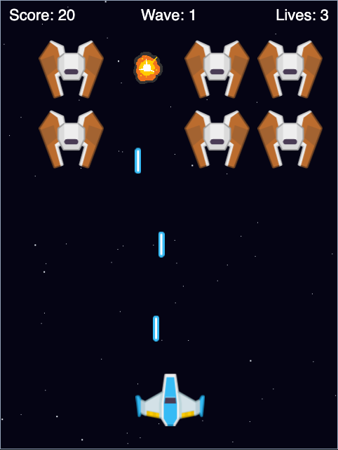
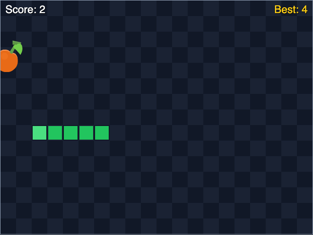
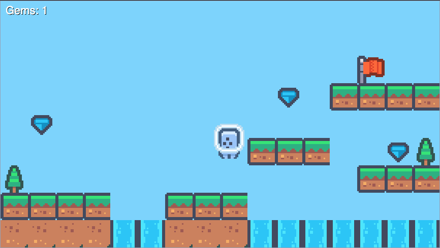

# Examples

Every game listed here ships with the sandbox and can be played directly
(with the sandbox running, open `http://localhost:4173/examples`, or the
**Examples** button in the sandbox's top bar) or cloned into your own
project from the sandbox's example gallery (except the import-mode Sandbox
Starter) — see
[`docs/sandbox.md#example-gallery`](sandbox.md#example-gallery).

## Learning path and code structure

| Level                   | Examples                                                         | Focus                                                           |
| ----------------------- | ---------------------------------------------------------------- | --------------------------------------------------------------- |
| Beginner                | Drawing Basics, Actor Movement, Animation Basics, Sound And Tone | One API or frame-loop concept at a time.                        |
| Next steps              | Storage Save, Sandbox Starter                                    | Async persistence and scoped application modules.               |
| Intermediate            | Breakout, Snake, Space Shooter                                   | Game states, collections, timers, and focused helper functions. |
| Intermediate / advanced | Platformer, Tappy Plane                                          | Tile physics and convex polygon collision.                      |

The global examples keep their game in one file so the sandbox can run it
directly. Modularity comes from named tuning constants, helpers for specific
jobs, and separate input, update, and drawing hooks. `draw()` presents state;
it does not advance gameplay. A small example does not need a class hierarchy
or a file per function to teach these boundaries clearly.

Read a complete game's constants and state first, then its reset function,
then `update()` and the helpers it calls, and finally `draw()`. Each README
explains the main concept and suggests an extension to try.

The sandbox preview runs only `main.js` as a script; it does not resolve ES
module imports. Sandbox Starter demonstrates actual module boundaries:
`game.ts` owns per-run game state, while `main.ts` connects it to the host page.

## Drawing Basics

Example route: `/examples/drawing-basics`

Draws a gradient background, a filled rectangle, a line, a circle, and a
polygon with `screen.draw`, and animates one shape's size using `update(dt)`.
No assets, no input — the smallest possible starting point for what `draw()`
can do. Teaches: `screen.fill`, the `screen.draw` primitives, and the basic
`update`/`draw` frame loop.

## Actor Movement

Example route: `/examples/actor-movement`

Loads `images/player.svg` into an `Actor` and moves it left/right with the
arrow keys, clamped to the window. Teaches: `Actor` positioning, reading
`keyboard` state inside `update(dt)`, and frame-rate-independent movement.

## Sound And Tone

Example route: `/examples/sound-tone`

Loads a sound effect from `sounds/click.ogg` and plays it — along with a
short generated `tone` — every time the canvas is clicked, growing a circle
with each click. Teaches: triggering audio from `on_mouse_down`, the
click-to-unlock browser audio rule, and `tone.play`.

## Animation Basics

Example route: `/examples/animation-basics`

Starts an `animate()` call as soon as the game loads and draws the animated
object moving smoothly across the screen using a `"decelerate"` tween.
Teaches: `animate()`, easing curves, and animating a plain object's
properties (not just an `Actor`'s).

## Storage Save

Example route: `/examples/storage-save`

Use the **+ 1** and **- 1** buttons to edit the current score, **Save current**
to persist it, and **Load saved** to restore it. Separate current and saved
score cards make each action visible. Reloading restores the saved score.
Teaches: `storage.get`/`storage.set`, asynchronous `storage.save()` / `load()`,
handling failed writes, and automatic loading when a game starts.

## Sandbox Starter

Example route: `/examples/sandbox-starter`

The one example that doesn't use zero-boilerplate globals. `game.ts` exports
a `defineGame()` factory with private state and scoped services; `main.ts`
selects the example page's canvas and calls `run()`. Arrow keys move the
circle, and a typed `onKeyDown(event)` hook resets it on space. Teaches:
module boundaries, per-run state ownership, and embedding a game in a host
page. See its README for the canvas markup and bundling requirements.

## Tappy Plane

A complete arcade game: tap or press space to boost upward against constant
gravity, dodge a stream of scrolling mountain gaps, and try to beat your high
score. Teaches: gravity/velocity movement, scrolling procedurally-spawned
obstacles, precise collision detection against multiple `Actor`s at once,
and a full game-over/restart loop with a high score backed by `storage`.

Example route: `/examples/tappy-plane`

## Breakout

A complete arcade game: steer a paddle with the keyboard or mouse to keep a
bouncing ball in play and clear a wall of bricks, racing against a limited
number of lives. Teaches: velocity-based ball physics and reflection,
collision against a grid of bricks, paddle input from both keyboard and
mouse, and win/lose states with scorekeeping.

Example route: `/examples/breakout`

## Space Shooter

A wave-based shoot-'em-up: fly with the arrow keys (or WASD), fire lasers
with space, and survive descending enemy formations that speed up with
every wave you clear. Teaches: multi-actor management (lasers, enemies,
explosions), frame-based animation, timed invulnerability, escalating
difficulty, and lives/score HUD drawing.

Example route: `/examples/space-shooter`

## Snake

The classic grid snake: steer with the arrow keys, eat fruit to grow, and
avoid the walls and your own tail. Movement is driven entirely by
`clock.schedule_interval`, and the game speeds up each time you eat.
Teaches: grid-based movement, the clock scheduling API, queued input,
and a persisted high score via `storage`.

Example route: `/examples/snake`

## Platformer

A single handcrafted level built from a tile-string map: run and jump with
the arrow keys, collect gems, and reach the goal flag — with forgiving
coyote-time jumping and a respawn if you fall off the world. Teaches:
tilemap level design, gravity and AABB tile collision, jump feel, and
collectibles.

Example route: `/examples/platformer`

## Assets

The example games' art and sound (where not generated in code, like
`sound-tone`'s inline tone/click effects) use free [CC0-licensed assets from
kenney.nl](https://kenney.nl/) — see the [README](../README.md#license-and-credits) for
the full credit.
