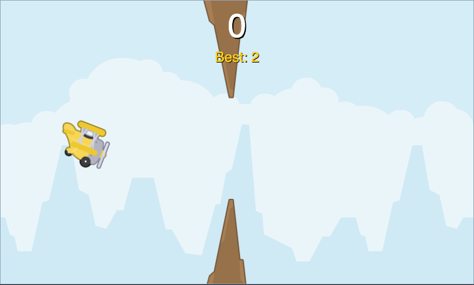
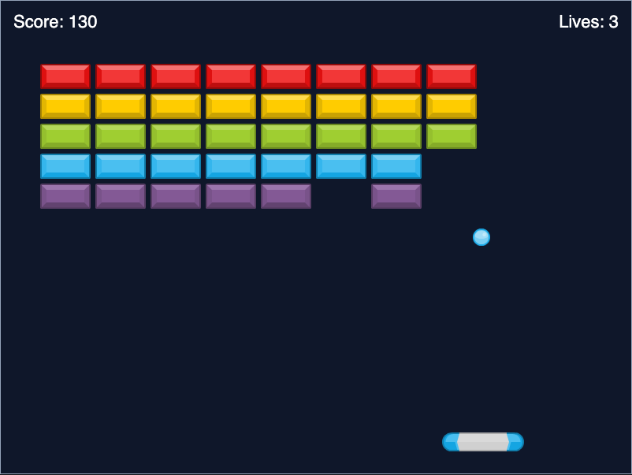

# Examples

Every game listed here ships with the sandbox and can be played directly
(with the sandbox running, open `http://localhost:4173/examples`, or the
**Examples** button in the sandbox's top bar) or cloned into your own
project from the sandbox's example gallery — see
[`docs/sandbox.md#example-gallery`](sandbox.md#example-gallery).

## Drawing Basics

Example route: `/examples/drawing-basics`

Draws a gradient background, a filled rectangle, a line, a circle, and a
polygon with `screen.draw`, and animates one shape's size using `update(dt)`.
No assets, no input — the smallest possible starting point for what `draw()`
can do. Teaches: `screen.fill`, the `screen.draw` primitives, and the basic
`update`/`draw` frame loop.

## Actor Movement

Example route: `/examples/actor-movement`

Loads `images/player.svg` into an `Actor` and moves it left/right with the
arrow keys, clamped to the window. Teaches: `Actor` positioning, reading
`keyboard` state inside `update(dt)`, and frame-rate-independent movement.

## Sound And Tone

Example route: `/examples/sound-tone`

Defines a sound effect from an inline data URL and plays it — along with a
short generated `tone` — every time the canvas is clicked, growing a circle
with each click. Teaches: triggering audio from `on_mouse_down`, the
click-to-unlock browser audio rule, and `tone.play`.

## Animation Basics

Example route: `/examples/animation-basics`

Starts an `animate()` call as soon as the game loads and draws the animated
object moving smoothly across the screen using a `"decelerate"` tween.
Teaches: `animate()`, easing curves, and animating a plain object's
properties (not just an `Actor`'s).

## Storage Save

Example route: `/examples/storage-save`

Increments a score every frame and persists it through `storage`, drawing
the current value to the canvas. Reload the page and the score picks up
where it left off. Teaches: `storage.get`/`storage.set` and automatic
save/load.

## Sandbox Starter

Example route: `/examples/sandbox-starter`

The one example that doesn't use zero-boilerplate globals — it `import`s
`run`, `screen`, and `keyboard` from `@js-game-zero/core` directly and
passes an explicit hooks object to `run()`, including a camelCase
`onKeyDown` alias. Teaches: the explicit import-mode API, for anyone
publishing outside the sandbox or preferring plain JavaScript modules over
injected globals.

## Flappy Bird

A complete arcade game: tap or press space to flap upward against constant
gravity, dodge a stream of scrolling rock gaps, and try to beat your high
score. Teaches: gravity/velocity movement, scrolling procedurally-spawned
obstacles, precise collision detection against multiple `Actor`s at once,
and a full game-over/restart loop with a high score backed by `storage`.

Example route: `/examples/flappy-bird`

## Breakout

A complete arcade game: steer a paddle with the keyboard or mouse to keep a
bouncing ball in play and clear a wall of bricks, racing against a limited
number of lives. Teaches: velocity-based ball physics and reflection,
collision against a grid of bricks, paddle input from both keyboard and
mouse, and win/lose states with scorekeeping.

Example route: `/examples/breakout`

## Assets

The example games' art and sound (where not generated in code, like
`sound-tone`'s inline tone/click effects) use free [CC0-licensed assets from
kenney.nl](https://kenney.nl/) — see the [README](../README.md#credits) for
the full credit.
