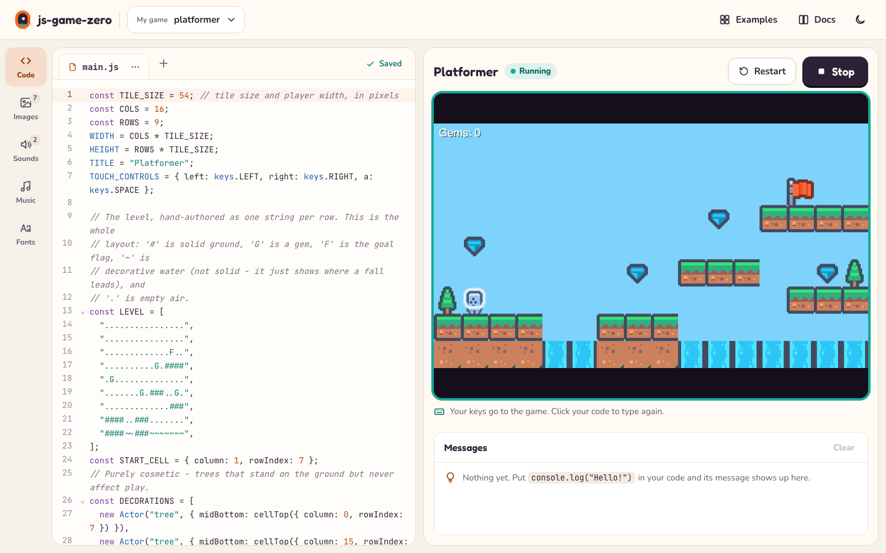
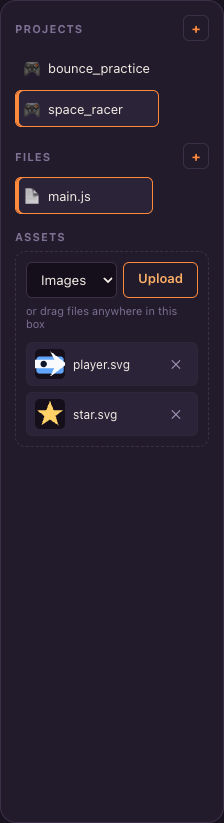
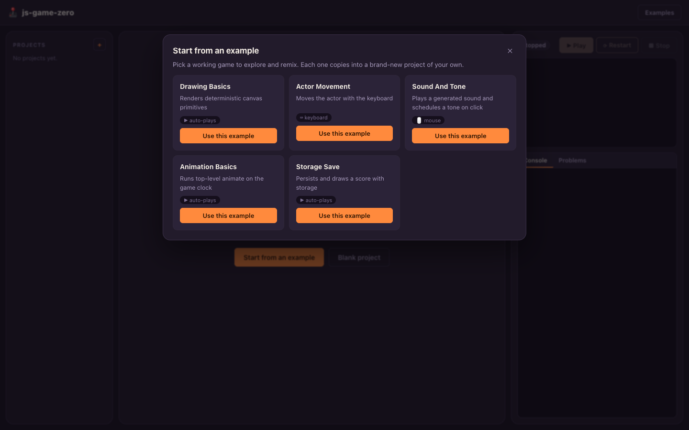

# Sandbox Guide

The sandbox is a local web app — a code editor, an asset manager, and a live
preview, all backed by a small Bun server that saves your work to disk as
you go. This page is a tour of the UI. For install/run instructions, see
[`docs/getting-started.md`](getting-started.md); for a hands-on build, see
[`docs/tutorial.md`](tutorial.md).

```sh
bun run dev:sandbox
```

Then open `http://localhost:4173`.



## Layout

The window is three columns:

- **Sidebar** (left) — your projects, the files inside the selected
  project, and its assets.
- **Editor** (center) — the code editor for whichever file is selected.
- **Preview** (right) — the Play/Stop/Restart controls, the live game
  preview, and a Console/Problems panel underneath it.

## Projects

Click **+** next to "Projects" to create a new one. You're asked how to
start:

- **Start from an example** opens a gallery of the shipped example games
  (see [`docs/examples.md`](examples.md)) — picking one clones its code and
  assets into a brand-new project of your own, which you're then free to
  edit however you like.
- **Blank project** starts from a small working game (an arrow-key-controlled
  circle with the label "Use the arrow keys!") so there's something on
  screen immediately, rather than a blank file.

Project names must start with a lowercase letter and contain only lowercase
letters, digits, `-`, and `_`. Each project in the list has a rename (✎) and
delete (✕) action; deleting a project removes every file inside it and
can't be undone.

The same example gallery is reachable any time via the **Examples** button
in the top bar, without going through project creation.

## Editor and files

Selecting a file in the **Files** section opens it in the editor (a
CodeMirror-based JavaScript editor with syntax highlighting). New projects
start with `main.js` selected automatically. Use **+** next to "Files" to
add another file — useful for splitting a bigger game into modules and
`import`-ing between them.

Changes save automatically about half a second after you stop typing; the
save status next to the editor toolbar reads "Unsaved changes" while a save
is pending, then "Saving…", then "Saved" (or "Couldn't save" with a toast
explaining why, if something went wrong). Press **Ctrl/Cmd+S**, or the
**Save** button, to save immediately instead of waiting.

## Assets

The **Assets** panel manages four kinds of file, matching the framework's
asset directories: **Images**, **Sounds**, **Music**, and **Fonts**, chosen
from the dropdown at the top of the panel.



- Click **Upload** to pick files from your computer, or drag files directly
  into the panel — dropped files are automatically sorted into the right
  asset directory by file type (audio files with "music" in the name go to
  Music, other audio to Sounds, fonts by extension, everything else to
  Images).
- Each uploaded asset gets a small preview (a thumbnail for images, a
  player for sounds/music) and a delete (✕) action.
- Reference an uploaded asset from code by its filename, lowercase, without
  the directory prefix — a file uploaded as `images/hero.png` is
  `new Actor("hero.png")` or `images.hero` in your code. See
  [`docs/reference/loaders.md`](reference/loaders.md) for the full naming
  grammar.

## Play, Stop, Restart

- **▶ Play** runs the selected project's `main.js` in the preview pane,
  flushing any unsaved edits first.
- **⟳ Restart** reloads the same project from scratch — use it after
  editing code while the game keeps running, since editing doesn't
  hot-reload the preview by itself.
- **■ Stop** ends the preview.

The status pill above the preview reads **Stopped**, **Running**, or
**Something went wrong** (if the game throws an uncaught error).

### Keyboard focus

The game preview runs inside an embedded frame, and browsers only deliver
keyboard events to whichever frame currently has focus. While a game is
running and the preview isn't focused, an overlay reading **"Click the game
to use your keyboard"** appears over it — click anywhere on the preview to
dismiss it and start sending it your key presses.

## Console and Problems

Below the preview, two tabs:

- **Console** shows anything your game logs with `console.log`/`info`/
  `warn`/`error`, in order, color-coded by level.
- **Problems** lists diagnostics from the runtime (see
  [`docs/reference/runtime.md`](reference/runtime.md#diagnostics)) and any
  uncaught errors, each with a line number when one is available. A badge
  on the tab shows the current count; the panel switches to Problems
  automatically the moment one appears.

Both are cleared each time you press Play or Restart, and when you switch
projects.

## Example gallery



Opened from the **Examples** button in the top bar, or from **Start from an
example** during project creation. Each card shows the game's title, a short
description of what it does, and an icon for how you interact with it
(keyboard, mouse, or none — it just plays). Clicking **Use this example**
prompts for a project name and clones the example's code and assets into a
new project. See [`docs/examples.md`](examples.md) for what each example
teaches.

## Command-line options

```sh
bun run dev:sandbox
```

serves on `http://127.0.0.1:4173` by default and stores projects in a
`.jgz-projects` directory next to wherever you ran the command. To use a
different port or an explicit (e.g. disposable) project directory:

```sh
bun apps/sandbox/src/server.ts --host 127.0.0.1 --port 4200 --projects-root /tmp/workshop-projects
```

## Server API (advanced)

The sandbox client talks to a small JSON API, useful if you're scripting
against it or building your own tooling on top:

| Method   | Path                                  | Purpose                                    |
| -------- | ------------------------------------- | ------------------------------------------ |
| `GET`    | `/api/health`                         | Liveness check.                            |
| `GET`    | `/api/projects`                       | List projects.                             |
| `POST`   | `/api/projects`                       | Create a project (`{name, exampleSlug?}`). |
| `GET`    | `/api/projects/:project`              | Project summary and file list.             |
| `POST`   | `/api/projects/:project/rename`       | Rename a project.                          |
| `DELETE` | `/api/projects/:project`              | Delete a project.                          |
| `GET`    | `/api/projects/:project/files/:path`  | Read content plus its save `version`.      |
| `PUT`    | `/api/projects/:project/files/:path`  | Versioned write or file creation.          |
| `DELETE` | `/api/projects/:project/files/:path`  | Delete a file.                             |
| `POST`   | `/api/projects/:project/files/rename` | Rename a file (`{from, to}`).              |
| `PUT`    | `/api/projects/:project/assets/:path` | Upload an asset (raw bytes).               |
| `DELETE` | `/api/projects/:project/assets/:path` | Delete an asset.                           |
| `GET`    | `/api/examples`                       | List cloneable example games.              |
| `GET`    | `/play/:project`                      | The preview page for a project.            |

Every project/file/asset route rejects path traversal, absolute paths,
encoded escapes, backslashes, and symlink escapes — file and asset paths are
always confined to their project's own directory on disk.

File writes send `{content, baseVersion, revision, sessionId}`. The server
serializes writes per path and compares revisions only within the same editor
session, so an unload-safe save cannot let stale content overwrite a newer edit
and one editor cannot supersede another editor's stale base. Mutation
requests carrying a foreign `Origin` are rejected; the separate learner
preview origin can read only its narrowly scoped source/assets and cannot use
the editor's project mutation API.
