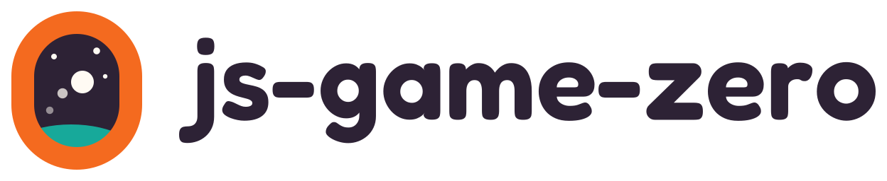

<picture>
  <source media="(prefers-color-scheme: dark)" srcset="https://raw.githubusercontent.com/Leaf-Learning/js-game-zero/main/docs/media/logo-lockup-dark.svg">
  
</picture>

# js-game-zero

A framework that teaches beginners to build browser games in JavaScript, with
as little boilerplate as possible, in the spirit of
[Pygame Zero](https://github.com/lordmauve/pgzero). Declare `WIDTH` and
`HEIGHT`, write a `draw()` function, and you have a game window: no build
step, no canvas setup, no game loop to write. Actors, drawing, geometry,
input, animation, sound and storage are all there.

```js
WIDTH = 480;
HEIGHT = 360;

let ship = new Actor("player.svg", { midBottom: [240, 350] });

function update(dt) {
  if (keyboard.left) ship.x -= 220 * dt;
  if (keyboard.right) ship.x += 220 * dt;
}

function draw() {
  screen.fill("#0b1220", "#132a43");
  ship.draw();
}
```

```sh
bun add js-game-zero
# or
npm install js-game-zero
```

## Use

`run()` takes a game's source as a string and runs it with the framework's
globals (`Actor`, `screen`, `keyboard`, `clock` and the rest) in its own scope:

```js
import { run } from "js-game-zero";

run(`
  WIDTH = 320;
  HEIGHT = 180;
  function draw() { screen.fill("navy"); }
`);
```

For a game written as an ordinary module with imports, `defineGame()` gives it
its own set of services, so two games on one page never share state:

```ts
import { defineGame, run } from "js-game-zero";

run(
  defineGame(({ Actor, screen, keyboard }) => {
    const player = new Actor("player.svg");
    return {
      WIDTH: 320,
      HEIGHT: 180,
      update(dt) {
        if (keyboard.right) player.x += 120 * dt;
      },
      draw() {
        screen.clear();
        player.draw();
      },
    };
  }),
);
```

`run()` also takes a plain object of hooks.

## Script tag

`js-game-zero/iife` (the file `dist/jgz.js`) is one self-contained script for
pages with no bundler. It puts the whole API on `window.JGZ`, with the host
APIs a page needs to start, drive and read a game it runs: `loadImages`,
`getGameInspector`, `serializeGameValue`, `parseStatePath` and
`createSeededRandom`.

Load it from a CDN such as jsDelivr, or copy the file next to your page.
`JGZ.run` adds the game's canvas to the page's `<body>`:

```html
<script src="https://cdn.jsdelivr.net/npm/js-game-zero@0.3/dist/jgz.js"></script>
<script>
  JGZ.run(`
    WIDTH = 320;
    HEIGHT = 180;
    function draw() { screen.fill("navy"); }
  `);
</script>
```

Problems with the game, from a misspelled name to an image that won't load,
go to the browser console, or to a `diagnostics` callback if you pass one. A
game that fails stops, and its canvas is removed. [Getting
started](https://github.com/Leaf-Learning/js-game-zero/blob/main/docs/getting-started.md#a-game-in-one-web-page)
has a complete page that shows them on the page, with images and sounds.

In TypeScript, `/// <reference types="js-game-zero/iife" />` declares
`window.JGZ`.

The file opens with its license notice, so a page that inlines it carries it.

## Entry points

| Import                             | What it holds                                                                                                         |
| ---------------------------------- | --------------------------------------------------------------------------------------------------------------------- |
| `js-game-zero`                     | The game API: `run`, `defineGame`, `Actor`, `Rect`, `screen`, `keyboard`, `clock`, `animate`, `storage` and the rest. |
| `js-game-zero/host`                | For pages and tools that embed games: asset loaders, browser adapters, the game inspector and the value serialiser.   |
| `js-game-zero/node`                | A file-system storage adapter for sandbox projects, under Node or Bun.                                                |
| `js-game-zero/iife`                | The script-tag build, `dist/jgz.js`, which puts the API on `window.JGZ`.                                              |
| `js-game-zero/reference`           | The API reference: `reference`, every page's Markdown by its file name (`reference["actor.md"]`).                     |
| `js-game-zero/reference/<page>.md` | Each reference page as a Markdown file.                                                                               |

To test a game from the terminal, press its keys and read its state, there's
the [`jgz` CLI](https://www.npmjs.com/package/@js-game-zero/cli).

## Docs

- [Tutorial](https://github.com/Leaf-Learning/js-game-zero/blob/main/docs/tutorial.md):
  build a complete game step by step.
- [API reference](https://github.com/Leaf-Learning/js-game-zero/tree/main/docs/reference):
  every symbol, with a signature, an explanation and an example. The
  [runtime page](https://github.com/Leaf-Learning/js-game-zero/blob/main/docs/reference/runtime.md)
  covers `run()`, its options and embedding games in a host page.
- [Cookbook](https://github.com/Leaf-Learning/js-game-zero/blob/main/docs/cookbook.md):
  short recipes for specific tasks.

## License

MIT. See [LICENSE](LICENSE).
